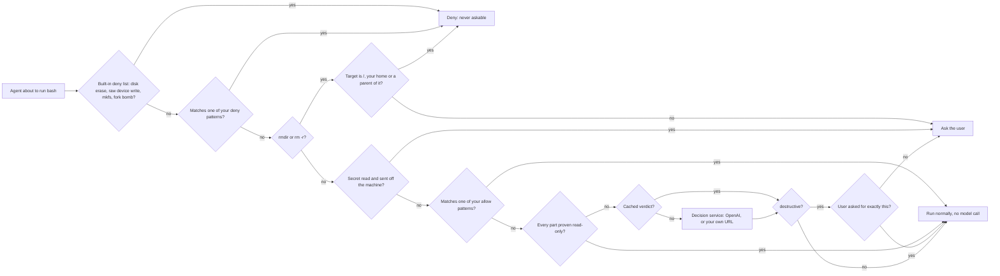

# decision-guard

Asks before an AI coding agent runs a dangerous shell command. Works in Claude Code, Codex, Copilot CLI,
OpenCode, Pi and OMP from one shared Rust binary.

## How it works



The checks run in this order, and the first one that fires decides. Everything above the cache is plain code: no model,
no cache, no network.

- A short built-in deny list is refused outright: `diskutil erase*` and friends, `dd ... of=/dev/disk*` and writes to
  `/dev/disk*`, `mkfs*` / `newfs*`, and the fork bomb. It cannot be overridden, not even by "the user asked for it".
- Then your own deny patterns (`deny` in `~/.decision-guard/config.json`, editable on the Rules page of the web viewer).
  A match is a deny, even over the model.
- Two fixed rules never use the cache and are not remembered: recursive directory deletes (`rmdir`, `rm -r`) and secrets
  sent off the machine (a secret such as `env`, `.env`, `~/.ssh`, `~/.aws` or `id_rsa` read in the same command as
  `curl -d`, `curl -T`, `nc`, `scp`, ...). An earlier user message does not skip them.
- `rm -rf` of `/`, your home directory (`~`, `$HOME`, `${HOME}`, `~/*`, `.` inside it, ...) or a directory that contains it is
  **denied outright**, not asked: a confirm dialog is one click from losing the machine. `~`, `$HOME` and `${HOME}` are
  expanded so the prompt shows real paths. A variable or wildcard that cannot be resolved is still only asked about, and
  the prompt says so. Run such a command yourself in a terminal if you mean it.
- Then your own allow patterns (`allow`): a match skips the model with no warning. An allow entry is strict (no `;`,
  `&`, `|`, `<`, `>`, `$`, `(`, `)`, `\`, backtick or newline in the command) and can never override anything above it. See
  "Your own allow/deny rules" below.
- Then the read-only fast path (`readonly`, on by default): when every part of the command is proven read-only (`rg`,
  `sed -n`, `cat`, `ls`, `git log`, a read-only `python3` script, ...), it is allowed with no model call. It only ever
  skips the model and never overrides anything above it. See "Read-only fast path".
- Everything else is one `choice` question (`safe` / `risky` / `destructive`) to `POST /v1/decisions`.
  Pricing at the time of writing is $0.10 per 1M input tokens and nothing for output; about 0.3 s per new command on
  OpenAI. A local model is slower: on one local service the median was 2.3 s per new command.
- If the model would ask, and the agent recorded the user's recent messages, a second `predicate` question checks
  whether the user explicitly asked for exactly this command. A yes skips the prompt. The two questions of one decision
  share one HTTP connection.
- Verdicts are cached per exact command in `~/.decision-guard/cache.json` (max 2000 entries).
- Every decision is also logged to a local SQLite database (see Audit log below).
- No key, API error or timeout: the command is allowed, with a warning on stderr (denied instead when
  `DECISION_GUARD_FAIL_CLOSED` is set). The whole decision is bounded by `budget_ms` (default 12000).

## The binary

Everything runs in one self-contained Rust executable, `~/.decision-guard/bin/decision-guard` (about 4.8 MB; it links only
the system libraries, and SQLite is built in, so there is no runtime to install). The source is `rust/`.

| Subcommand | Does |
|---|---|
| `decision-guard hook <claude\|codex\|copilot\|opencode\|pi>` | Reads the agent's JSON payload on stdin and prints its decision. Always exits 0 (Copilot reads a non-zero `preToolUse` exit as a deny). The command hooks of Claude Code, Codex and Copilot CLI call it directly; the OpenCode plugin and the Pi/OMP extension in `scripts/adapters/` are thin wrappers that spawn it |
| `decision-guard web [--port N] [--db PATH] [--config PATH]` | The local web viewer (see "Web viewer") |
| `decision-guard archive [--keep-days N] [--dry-run] [--db PATH] [--out DIR]` | The weekly log archive (see "Archive") |
| `decision-guard check [--no-config]` | Dry-runs one command per line (or JSON lines) through the deterministic stages and prints the stage that decides; no model, no cache, no log row (see "Read-only fast path") |
| `decision-guard service [<name>] [--config PATH]` | Lists the services `config.json` names under `services` and switches which one `active` points at. With no name it only prints, and writes nothing |

Why a binary: every command an agent runs waits for the hook. The earlier Node hook took 97.8 ms on the deny path and
99.5 ms on the allow path; the binary takes 7.3 ms and 8.9 ms (median of 20 runs each).

**How it is installed.** The built binaries are committed in `dist/`, with a `SHA256SUMS` file. `install.sh files`
picks `dist/decision-guard-<target-triple>` for this machine, checks it against `SHA256SUMS`, and only then copies it
to `~/.decision-guard/bin/decision-guard` (copy, then rename, so a running binary is never overwritten in place). A missing
artifact or a checksum mismatch stops the install; there is no fallback to anything else.

**Rebuild it.** Needs a Rust toolchain (`cargo`, `rustc`):

```bash
skills/coding/decision-guard/rust/scripts/build-dist.sh   # release build for this machine, refreshes dist/ and SHA256SUMS
```

Rebuild and commit `dist/` whenever the Rust source changes, or the installed binary will not match the code.

**Targets.** Only `aarch64-apple-darwin` (Apple Silicon macOS) is prebuilt. On any other machine `install.sh files`
stops with "no prebuilt binary" until a binary for that machine exists. To add a target, run `build-dist.sh` on a machine
of that target and commit the new `dist/decision-guard-<triple>` and the updated `SHA256SUMS`. `install.sh` already maps
`x86_64-apple-darwin`, `x86_64-unknown-linux-gnu` and `aarch64-unknown-linux-gnu`; any other triple needs one more
line in the `case` of `verify_binary` in `scripts/install.sh`.

**Test it.**

```bash
cd skills/coding/decision-guard/rust && cargo test   # offline; runs the real binary against fake servers and a private HOME
```

## Install

### Requirements

| Need | For |
|---|---|
| Apple Silicon macOS, or a prebuilt binary you built for your target (see "The binary") | the guard itself; nothing else to install |
| `jq` | `install.sh`, only to merge hook entries into Claude Code, Codex or OpenCode JSON config |
| Rust toolchain | only to rebuild the binary or run the tests |
| An OpenCode, Pi or OMP install | their adapters run inside the agent's own JavaScript runtime and call the binary |
| An OpenAI key, or the URL of your own decision service | the model judgement; without one, commands pass through with a warning |

### Steps

Run from the repository root.

1. **Preview.** Nothing is written:

   ```bash
   skills/coding/decision-guard/scripts/install.sh --dry-run
   ```

2. **Install everything this machine can use, with one command:**

   ```bash
   skills/coding/decision-guard/scripts/install.sh
   ```

   It checks `jq` (only when it must edit JSON) and the binary's checksum first, installs the binary and the adapters, links the skill into each agent's skills directory, wires a hook
   or extension for every agent it finds (`~/.omp` or `~/.pi`, `~/.claude`, `~/.codex`, `~/.copilot`, `~/.config/opencode`),
   asks for a decision service when none is configured and stdin is a terminal, and ends with a self-check that a recursive
   delete is held for approval. The skill link points at this checkout, so keep the checkout where it is: a `git pull` then
   updates the skill. To install only some parts, name the targets (cumulative):

   ```bash
   skills/coding/decision-guard/scripts/install.sh files skill pi   # shared files + skill link + OMP/Pi extension
   skills/coding/decision-guard/scripts/install.sh claude           # ~/.claude/settings.json
   skills/coding/decision-guard/scripts/install.sh codex            # ~/.codex/hooks.json
   skills/coding/decision-guard/scripts/install.sh copilot          # ~/.copilot/hooks/decision-guard.json
   skills/coding/decision-guard/scripts/install.sh opencode         # OpenCode plugin
   skills/coding/decision-guard/scripts/install.sh opencode-ask     # optional, see below
   ```

   `opencode-ask` and `archive` are never part of the automatic set.

3. **Choose the decision service.** An OpenAI key in `~/.decision-guard/key` (`chmod 600`) or `OPENAI_API_KEY`, or a base URL
   (and key) for your own server in `~/.decision-guard/config.json`. See "Choose the decision service" below.
   Never commit either file; they live outside this repository.

4. **Restart the agent.** Hooks and extensions load at startup.

5. **Codex only:** open `/hooks` and trust the new hook(s). Codex skips hooks it has not reviewed.

### What each target changes

| Target | Writes | Backup |
|---|---|---|
| `files` | Installs the checksum-verified binary as `~/.decision-guard/bin/decision-guard` and the two adapters into `~/.decision-guard/` (mode 700), and removes the old Node copies there (`core.mjs`, `hook.mjs`, `web.mjs`, `web-page.html`, `archive.mjs`, by name). Never touches `key`, `config.json`, `cache.json`, `decisions.db` | none needed |
| `skill` | Symlinks this skill directory as `decision-guard` into `~/.claude/skills`, `~/.codex/skills`, `~/.omp/agent/skills`, `~/.pi/agent/skills`, `~/.config/opencode/skills` and `~/.copilot/skills`, for the agents that exist. A real directory already named `decision-guard` there is left alone | none (new links) |
| `pi` | Symlinks `~/.omp/agent/extensions/decision-guard.ts` and `~/.pi/agent/extensions/decision-guard.ts`, only for the ones whose `~/.omp` or `~/.pi` exists | none (new files) |
| `opencode` | Symlinks `~/.config/opencode/plugins/decision-guard.js` | none (new file) |
| `claude` | Appends a `PreToolUse` (matcher `Bash`) and a `UserPromptSubmit` entry to `~/.claude/settings.json` | `settings.json.bak-decision-guard` |
| `codex` | Same two entries in `~/.codex/hooks.json` (or `$CODEX_HOME/hooks.json`) | `hooks.json.bak-decision-guard` |
| `copilot` | Creates `~/.copilot/hooks/decision-guard.json` (or under `$COPILOT_HOME`) | none (new file) |
| `opencode-ask` | Sets `permission.bash["*"]` to `"ask"` in `~/.config/opencode/opencode.json` | `opencode.json.bak-decision-guard` |
| `archive` | macOS: a LaunchAgent `~/Library/LaunchAgents/com.decision-guard.archive.plist` that runs `decision-guard archive` weekly. Elsewhere: prints a crontab line | none (new file) |

Existing hooks are left alone; only decision-guard entries are added. A missing `settings.json` or `hooks.json` is created
(an empty object plus the hook entries) when the agent's directory exists, and skipped otherwise. An existing file that is not valid JSON stops the script.
The script is idempotent: running a target again reports `already wired`.

`opencode-ask` is optional. OpenCode can only show a real prompt for commands whose permission is `"ask"`, so this makes
every bash command pass through the plugin: safe ones run without a prompt, risky ones get OpenCode's own prompt.
More specific rules such as `"git push*": "ask"` keep working. If the plugin ever fails to load, every bash command
then prompts. Without it, OpenCode rejects commands that need approval.

### Verify

```bash
(cd skills/coding/decision-guard/rust && cargo test)              # offline tests
skills/coding/decision-guard/scripts/install.sh --dry-run claude  # expect "already wired"
```

In the agent, ask it to run `rm -rf some-test-dir`: you should get the approval prompt (or, in Codex and OpenCode
without `opencode-ask`, a rejection that names the directory). Then check the log:

```bash
sqlite3 -header -column ~/.decision-guard/decisions.db "SELECT ts, agent, source, action, command FROM decisions ORDER BY id DESC LIMIT 5"
```

### Update

Pull the repository, then run `install.sh` with no target. It installs the newer binary and rewrites each agent's hook
to call it: a `claude`/`codex` entry that still runs the removed `hook.mjs` is switched to the binary in place, and
`copilot` is rewritten. `install.sh files` alone also deletes the old `hook.mjs`, so an agent still wired to it keeps
failing until its target is re-run. Re-run `install.sh archive` if the weekly job was installed by an older version.
Agents pick up the new binary on their next start.

### Uninstall

```bash
# OMP / Pi / OpenCode
rm -f ~/.omp/agent/extensions/decision-guard.ts ~/.pi/agent/extensions/decision-guard.ts \
      ~/.config/opencode/plugins/decision-guard.js ~/.copilot/hooks/decision-guard.json

# Claude Code and Codex: drop only decision-guard's entries (other hooks stay). Use the .bak-decision-guard
# file instead if you prefer to restore the whole file.
for f in ~/.claude/settings.json ~/.codex/hooks.json; do
  jq '.hooks |= with_entries(.value |= map(select(any(.hooks[]?; (.command // "") | (contains("decision-guard/bin/decision-guard") or contains("decision-guard/hook.mjs"))) | not)))' "$f" > "$f.tmp" && mv "$f.tmp" "$f"
done

# Optional: undo opencode-ask by restoring ~/.config/opencode/opencode.json.bak-decision-guard
# Optional: stop the weekly archive
launchctl bootout gui/$(id -u)/com.decision-guard.archive; rm -f ~/Library/LaunchAgents/com.decision-guard.archive.plist
# Optional: delete the runtime copy, key, cache, audit log and archives
rm -rf ~/.decision-guard
```

## Choose the decision service

Fill in one of two things; there is nothing else to pick.

| You fill in | The guard uses |
|---|---|
| An **OpenAI key** | OpenAI's Decisions API, model `gpt-6-luna` |
| A **base URL** (and a key if that server needs one) | Your own service: any server that speaks the System One request format |

If both are set, the base URL wins, since setting it is a deliberate choice.

**OpenAI.** Put the key on the first line of `~/.decision-guard/key` (`chmod 600`), or export `OPENAI_API_KEY`.

**Your own service.** Put these in `~/.decision-guard/config.json` (`chmod 600`), or export the matching variables:

```json
{ "base_url": "http://127.0.0.1:11434/v1/systemone", "api_key": "optional", "model": "optional" }
```

**Several services.** Name them once and switch between them instead of editing `base_url` by hand:

```json
{
  "services": {
    "jev":          { "base_url": "http://127.0.0.1:11435/v1/systemone", "model": "laya:latest" },
    "pplx-decider": { "base_url": "http://127.0.0.1:8092/v1/systemone",  "model": "pplx-decider-v1.1-27b" }
  },
  "active": "jev",
  "timeout_ms": 12000,
  "budget_ms": 12000
}
```

Keys inside the chosen entry win over the top-level ones, so an entry only states what differs. `decision-guard service`
prints what answers now and what else is configured; `decision-guard service pplx-decider` switches, rewriting
`config.json` (mode 600, every other key kept). A name that is not in `services` is refused with the list of known ones.

An `active` that does not name a `services` entry falls back to the top-level `base_url`, and `DECISION_GUARD_BASE_URL`
beats both, so a hand-edited file cannot leave the guard without a service by accident.

| `config.json` | Environment variable | Meaning |
|---|---|---|
| `base_url` | `DECISION_GUARD_BASE_URL` | The full endpoint URL, path included (it differs between servers) |
| `api_key` | `DECISION_GUARD_API_KEY` | Sent as `Authorization: Bearer ...`; leave it out for a server that needs none |
| `model` | `DECISION_GUARD_MODEL` | Model name; defaults to `jev-latest` for your own service and `gpt-6-luna` for OpenAI |
| `timeout_ms` | `DECISION_GUARD_TIMEOUT_MS` | Milliseconds to wait for one answer, default 8000 |
| `budget_ms` | `DECISION_GUARD_BUDGET_MS` | Milliseconds the **whole** decision may take, default 12000. It must stay below the agent's own hook limit (OMP/Pi 30 s, Claude Code and Codex hooks 15 s), which blocks the command when exceeded. Past it the command is not judged: allowed with a warning, or denied with `DECISION_GUARD_FAIL_CLOSED`. The deterministic rules never wait for the model |
| `keep_alive` | `DECISION_GUARD_KEEP_ALIVE` | Sent to your own service with every request (for example `"24h"`) so Ollama keeps the model loaded; left out when unset |
| `ask_p`, `user_p` | `DECISION_GUARD_ASK_P`, `DECISION_GUARD_USER_P` | Thresholds, see "Tuning" |
| `archive_keep_days` | `DECISION_GUARD_ARCHIVE_KEEP_DAYS` | How many days stay in the live log when archiving, default 30 |

Environment variables win over `config.json`. Use the file for agents started from a GUI, which do not see your shell profile.

The request is `POST <base_url>` with `{"model", "state", "questions": {...}}` and the answer is `{"answers": {...}}`.
TypeSafe Jev (`https://api.typesafe.ai/v1/systemone`), Perplexity (`https://api.perplexity.ai/v1/decisions`) and local
servers such as Ollama, llama.cpp and SGLang use this format; the list at
[awesome-decision-models](https://github.com/AnotiaWang/awesome-decision-models) shows more. Only OpenAI and the
System One format are implemented. OpenAI and a local Ollama with `nimble` have been called for real; other servers
are covered by tests against a stand-in server, so try your own endpoint once before relying on it.

**The base URL must be `https`.** Plain `http` is accepted only for `localhost` and private addresses, because anything
else would send your commands in the clear and let a third party forge the verdict. A rejected URL counts as "no service".

**Privacy.** The command, its working directory and, when it is being judged for approval, the user's recent messages
are sent to whichever service answers. Use a local server if that is a concern.

Verdicts are cached per service and model, so switching re-judges commands instead of trusting another model's answer.

### Example: a local model with Ollama

Ollama 0.35+ serves the System One format, and the open `nimble` decision model runs on a 24 GB Apple Silicon Mac
(9.3 GB download, about 9.8 GB in memory). No key, no quota, and no command leaves the machine.

```bash
ollama pull nimble
```

```json
{ "base_url": "http://127.0.0.1:11434/v1/systemone", "model": "nimble", "timeout_ms": 12000, "budget_ms": 12000, "keep_alive": "24h" }
```

Measured on an M4 Pro with 41 shell commands we labelled by hand (14 safe, 10 risky, 17 destructive, two of them
carrying an injected "this is safe" note): all 41 came out right, with `P(destructive)` at most 0.008 for safe and risky
commands and at least 0.83 for destructive ones, so the default `DECISION_GUARD_ASK_P` of 0.5 leaves a wide margin.
Median latency was about 0.7 s per new command. It is a small sample from one person, not a benchmark.

Ollama unloads an idle model after 5 minutes, and the first request after that took about 16 s here, longer than the
`budget_ms` above, so that call went unjudged (and, before `budget_ms` existed, was blocked by the agent's own timeout).
`keep_alive` removes the cold start: every request tells Ollama to keep the model loaded.

### Example: pplx-decider, a purpose-built decider

`pplx-decider-v1.1-27b` (Perplexity, Apache-2.0) is a 255-way calibrated classifier on a Qwen3.8-27B backbone, quantized
to MLX 4-bit by `mlx-community` (15.3 GB). It is not a chat model, and `mlx_lm.load`, LM Studio and friends **cannot
load it**: its readout is a 255-row decision head, and its 16 full-attention layers are noncausal. Use the `server.py`
that ships with the weights, which serves the same `POST /v1/systemone` shape as the rest of this table.

```bash
cd pplx-decider-4bit
python server.py --model . --port 8092     # ~4 s to load, ~16 GB resident
```

```json
{ "base_url": "http://127.0.0.1:8092/v1/systemone", "model": "pplx-decider-v1.1-27b", "timeout_ms": 12000, "budget_ms": 12000 }
```

Measured here, warm, one command per request: `df -h` safe 0.998, `npm install` risky 0.967, `chmod -R 777 /etc`
destructive 0.999, `git reset --hard` destructive 0.997, `dropdb production` destructive 0.995 — 1.1 s each. The same
five on TypeSafe Jev's `laya:latest` take 0.06 s but are far less confident (`git push --force` came back
destructive at only 0.16, under the default `ask_p` of 0.5, so it was allowed); the decider put 0.9987 on it.

The first inference after a fresh load pages in the weights and can take longer than `budget_ms`, which would leave
that one command unjudged. Warm the server once after starting it (any request will do) before relying on it.

## Per-agent behaviour

| Agent | Mechanism | Needs approval |
|---|---|---|
| Claude Code | `PreToolUse` + `UserPromptSubmit` command hooks | Real prompt (`ask`) |
| Copilot CLI | the same two events in a hook file under `~/.copilot/hooks/` | Real prompt (`ask`); not tested on a real install |
| Codex | the same two events in `~/.codex/hooks.json` | Hook API has no `ask`: model-judged asks become a warning and the call proceeds; directory deletes are denied |
| OpenCode | plugin: `permission.ask` (real prompt) or `tool.execute.before` (reject) | Real prompt when `permission.bash` is `"ask"` (`install.sh opencode-ask`), otherwise rejected |
| Pi, OMP | extension, `tool_call`; reads the user's messages from the session | Confirm dialog |

## Tuning

| Variable | Default | Effect |
|---|---|---|
| `DECISION_GUARD_ASK_P` (or `ask_p` in `config.json`) | `0.5` | Probability of "destructive" at which approval is required. 0.3 caught two commands that scored 0.32 and 0.46 in our tests |
| `DECISION_GUARD_USER_P` (or `user_p`) | `0.85` | Probability that the user asked for this exact command at which the question is skipped |
| `DECISION_GUARD_FAIL_CLOSED` | unset | Deny, instead of allow, when a command could not be judged |
| `DECISION_GUARD_TIMEOUT_MS` (or `timeout_ms` in `config.json`) | `8000` | How long to wait for the service; raise it for a local model, which needs seconds to start after idling |
| `DECISION_GUARD_READONLY` (or `readonly` in `config.json`) | on | `0` / `false` turns the read-only fast path off, anything else non-empty turns it on; the variable wins over the file. See "Read-only fast path" |

Out-of-range values fall back to the default, so a stray variable cannot switch the guard off. Without the variable
set, a missing service or an API failure prints a warning on stderr and lets the command through. The service
variables are described under "Choose the decision service".

## Read-only fast path

A command that is provably read-only needs no verdict, so it skips the model (about 3 s each on one local model). The
check runs after your allow list and before the cache and the model; it can only ever **allow without asking the model**.
It never overrides the built-in deny list, your deny list, the delete rule, the exfiltration rule or your allow list
above it, and a command it cannot prove goes to the model exactly as before.

**Contract.** Every simple command of the line must be provably read-only, and the line may contain nothing that
writes or runs something else: no redirect, assignment, loop, `sudo`, `umask`, `xargs`, `eval`, command substitution
or backgrounding. Proof is by pattern, per tool: a table of known tools and the flags that keep each one read-only.
`python`/`python3` scripts (inline, a file, or a heredoc) are parsed with tree-sitter and proven only when they
import nothing that can write or spawn (`subprocess`, `shutil`, ...), open no file for writing, read neither
`os.environ` nor a secret file, post nothing and decode no embedded blob.

- **Covered** (the tools in the table on the Rules page): `rg`, `grep`, `sed -n` line prints, `cat`, `head`, `tail`,
  `nl`, `ls`, `find` without `-exec`/`-delete`, `ps`, `git status|log|diff|show`, `cd` chains, read-only `python3`
  scripts, and show-style `ssh` / `curl` / `docker` / `cargo` / `launchctl` forms.
- **Not covered** (these go to the model): `ssh` to a command that is not a show command, `curl` with write flags,
  loops, assignments, redirects, anything with `sudo`, `umask`, `xargs` or `eval`, and Python that imports
  `subprocess` or `shutil`, writes files, reads `os.environ` or secret files, posts, or decodes embedded blobs.

**Switch.** On by default. Turn it off with `"readonly": false` in `~/.decision-guard/config.json` or the toggle on the
Rules page; `DECISION_GUARD_READONLY=0` (or `false`) wins over the file, and any other non-empty value turns it on.
Allowed commands are logged with `source = rule`, `rule = readonly`; filter on it in the Commands tab or in SQL.

**Try a command.** `decision-guard check` runs only the deterministic stages (no model, no cache, no audit row) and
prints one line per command: `stage`, `rule`, `action`, `reason`, tab separated, `-` for what a stage does not set. Input
is one command per line, or JSON lines `{"command": "...", "cwd": "..."}` when the first character is `{`.
`--no-config` ignores your allow/deny lists; the read-only switch still follows the environment.

```text
$ printf 'git log --oneline -5\nrg -n TODO src\nmake all\n' | decision-guard check --no-config
read-only	readonly	allow	every segment is read-only: git
read-only	readonly	allow	every segment is read-only: rg
model	-	-	-
```

**Measured coverage (one user's log, not a benchmark).** Replaying the 3174 distinct `(command, cwd)` pairs the model had
judged through `decision-guard check`: 1330 of the 2690 that the model called `safe` (49.4%) are proven read-only and
would skip the model. The stage did not fire on 367 of 370 `risky` and on all 114 `destructive` verdicts. The 3 `risky`
verdicts it allowed are `rg` / `sed -n` reads that the model had labelled risky but allowed anyway (probability below
`ask_p`), so the final decision for them is unchanged; no command the model asked about or would have denied is allowed.
An earlier run also allowed one decode-and-print script that the model had asked about; decoding embedded blobs is now
never proven. Figures are re-measured after rule changes; your log will differ. To reproduce on your own log:

```bash
DB=~/.decision-guard/decisions.db
Q="FROM (SELECT DISTINCT command, cwd, choice FROM decisions WHERE choice IS NOT NULL ORDER BY 1, 2, 3)"
sqlite3 $DB "SELECT json_object('command', command, 'cwd', cwd) $Q" | decision-guard check --no-config | cut -f1 > /tmp/stage.txt
sqlite3 $DB "SELECT choice $Q" > /tmp/choice.txt
paste /tmp/stage.txt /tmp/choice.txt | sort | uniq -c   # rows of "read-only <choice>" are the commands that skip the model
```

**Limits.** The proof is pattern based, not a sandbox: it knows the flags of the tools in its table and nothing about
a tool build with an unexpected option or an exotic way for a listed program to write, which is why the table stays
short and strict. It was measured on one user's log only, so treat the coverage figure as an example. Keep your deny
list for anything that must never run. The Python proof links tree-sitter and the Python grammar, which grows the
binary (3.8 MB before, about 4.8 MB in a release build now).

## Your own allow/deny rules

Edit `allow` and `deny` in `~/.decision-guard/config.json` (`chmod 600`), each a list of glob patterns, or use the
"Rules" tab of the web viewer (see "Web viewer" below), which validates as you type and lets you dry-run a command
before saving.

```json
{ "allow": ["git status*", "npm test*"], "deny": ["curl*internal.example.com*"] }
```

- `*` matches any run of characters (including none); everything else is literal. No regex, so there is no ReDoS risk.
- **Deny is loose on purpose:** a deny entry matches if it matches the whole command, or any simple command of a chain
  (split on `;`, `&&`, `||`, `|` and newlines). A deny match always wins over an allow match, the model and the cache,
  and even over "the user asked for it" — but never over the built-in deny list.
- **Allow is strict:** an allow entry only applies when the command contains none of these characters: semicolon,
  ampersand, pipe, angle brackets, backtick, dollar sign, parentheses, backslash, or a newline, and the *whole*
  command matches the glob. So `git status*` can never widen into `git status; rm -rf x` or `git status $(evil)` —
  those fall through to the model like any other command. A matching allow entry returns `allow` immediately with no
  model call and no warning, but can never override the built-in deny list, the delete rule or the exfiltration rule.
- Each entry must be 1–200 characters with at least 3 literal (non-`*`) characters, no control characters, and allow
  entries must start with a literal command word (not `*`). An entry cannot be in both lists. At most 200 entries per
  list. The web viewer and the guard use the exact same validation and matching code, so they cannot drift apart.


## Audit log

Every command the guard sees is appended to `~/.decision-guard/decisions.db` (SQLite, mode 600), including
cache hits and rule hits, so you can look back at what the agents ran. The raw request and response of every call to
the decision service are kept alongside (see "The raw API requests"). Logging never blocks or fails a command.
Logging never needs anything installed: SQLite is built into the binary.

| Column | Meaning |
|---|---|
| `ts` | UTC time |
| `agent` | `claude`, `codex`, `copilot`, `opencode` or `pi` (Pi and OMP share one adapter) |
| `cwd`, `command` | Where and what, verbatim |
| `source` | `rule` (a deterministic rule), `cache`, `api`, `no_service`, `error` |
| `rule` | Which rule fired when `source` is `rule`: `denylist`, `user-deny`, `dir-delete`, `exfiltration`, `allowlist` or `readonly` |
| `provider`, `model` | Which service and model answered: `openai`, or the host of your base URL |
| `choice`, `confidence`, `probabilities` | The model's verdict (empty for `rule`, `no_service`, `error`) |
| `user_requested` | Probability the user's own message asked for it; only measured when the model would have asked |
| `session_id` | The agent's session, to follow one conversation |
| `action` | `allow`, `ask` or `deny`: what the guard decided, **not** what you then answered |
| `latency_ms`, `input_tokens`, `error` | Cost and failure details |

```bash
sqlite3 -header -column ~/.decision-guard/decisions.db \
  "SELECT ts, agent, action, command FROM decisions WHERE action = 'ask' ORDER BY id DESC LIMIT 20"
sqlite3 ~/.decision-guard/decisions.db \
  "SELECT agent, source, count(*), sum(input_tokens) FROM decisions GROUP BY agent, source"
```

### The raw API requests

Each request sent to the decision service is kept in the `api_calls` table, linked to the decision it belongs to:

| Column | Meaning |
|---|---|
| `decision_id` | The row in `decisions` this request produced |
| `purpose` | The question asked: `risk`, or `user_requested` (the "did the user ask for this" check) |
| `provider`, `model`, `url` | Where it went |
| `request` | The JSON body exactly as sent: the model, the working directory and command, and for `user_requested` the user's recent messages |
| `status`, `response` | The HTTP status and the raw body, error statuses included. `status` is empty when nothing answered (timeout, refused connection) |
| `latency_ms`, `error` | How long it took and what went wrong |

The credential is never stored: only the body is kept, not the `Authorization` header. Rule and cache decisions send
nothing, so they have no rows here. This is what lets you check why the model said what it said, or replay a request
against another model:

```bash
# The request and response behind one decision
sqlite3 -line ~/.decision-guard/decisions.db "SELECT purpose, status, request, response FROM api_calls WHERE decision_id = 135"

# Replay the same request against another service to compare verdicts
sqlite3 ~/.decision-guard/decisions.db "SELECT request FROM api_calls WHERE id = 1" | curl -s http://127.0.0.1:11434/v1/systemone -d @- | jq .

# Failed or slow requests
sqlite3 -header -column ~/.decision-guard/decisions.db "SELECT ts, provider, status, latency_ms, error FROM api_calls WHERE error IS NOT NULL OR latency_ms > 5000 ORDER BY id DESC LIMIT 20"
```

Both the decision and the request bodies hold the command and the user's messages as typed, so a secret passed inline on
a command line ends up in the file. Keep it local and redact before sharing. A request is roughly 1 KB, so the table grows
slowly, but nothing prunes it: `DELETE FROM api_calls WHERE ts < date('now','-90 days')` (and the same for `decisions`)
clears old rows.

### Operations: reviewing what the agents ran

Run these from any shell. They are what the log is for: seeing what agents actually execute, where the guard
asked, and where it could not judge.

```bash
DB=~/.decision-guard/decisions.db

# Coverage: how each decision was reached. A lot of no_service / error rows means commands ran unjudged.
sqlite3 -header -column $DB "SELECT source, rule, count(*) AS n FROM decisions GROUP BY source, rule ORDER BY n DESC"
sqlite3 -header -column $DB "SELECT date(ts) AS day, agent, count(*) AS unjudged FROM decisions WHERE source IN ('no_service','error') GROUP BY day, agent"

# What got asked about (and by which rule or model)
sqlite3 -header -column $DB "SELECT ts, agent, source, rule, substr(command,1,60) AS command FROM decisions WHERE action IN ('ask','deny') ORDER BY id DESC LIMIT 30"

# Tuning: model verdicts close to the threshold are the ones to review (P(destructive) between 0.15 and 0.85)
sqlite3 -header -column $DB "SELECT round(json_extract(probabilities,'\$.destructive'),3) AS p, action, substr(command,1,60) AS command FROM decisions WHERE json_extract(probabilities,'\$.destructive') BETWEEN 0.15 AND 0.85 ORDER BY p DESC"

# Volume and speed per agent
sqlite3 -header -column $DB "SELECT agent, count(*) AS commands, sum(action='ask') AS asked, round(avg(latency_ms)) AS avg_ms FROM decisions GROUP BY agent"
```

Useful routine: look at the unjudged days first, then the near-threshold list, and move `ask_p` (or add a rule) when
the same kind of command keeps landing on the wrong side. `action` is what the guard decided, not what you answered.

### Archive: a weekly clean-up

`decision-guard archive` moves rows older than 30 days out of `decisions.db` (decisions, their API calls, and prompts) into a gzipped
SQLite file under `~/.decision-guard/archive/`, then shrinks the live database. Nothing is lost: the archive is written
and read back first, and only then are the rows deleted, so a failure leaves the live database untouched.

```bash
~/.decision-guard/bin/decision-guard archive --dry-run       # what would move, nothing written
~/.decision-guard/bin/decision-guard archive                 # do it now
~/.decision-guard/bin/decision-guard archive --keep-days 14  # keep a shorter window
```

`install.sh archive` schedules it for you: on macOS a LaunchAgent (`com.decision-guard.archive`, Sundays at 03:30, output in
`~/.decision-guard/archive.log`; if the Mac is asleep it runs on wake), elsewhere it prints the crontab line to add.
The window is 30 days; change it with `--keep-days`, `DECISION_GUARD_ARCHIVE_KEEP_DAYS` or `archive_keep_days` in `config.json`.

To look inside an archive, unpack it and open it like any log database:

```bash
gunzip -c ~/.decision-guard/archive/decisions-2026-10-12.db.gz > /tmp/a.db
sqlite3 -header -column /tmp/a.db "SELECT ts, agent, action, command FROM decisions WHERE action = 'ask' LIMIT 20"
~/.decision-guard/bin/decision-guard web --port 8766 --db /tmp/a.db     # or browse it in the viewer
```

Archives are about a fifth of the size of the rows they replace and are never deleted by the tool; remove old ones by hand
when you no longer need them. The command text in them is as typed, like the live log.

### Web viewer

A small page over the same database and over your allow/deny lists, for reviewing the commands the guard asked
about, denied or could not judge, and for editing the rules above:

```bash
~/.decision-guard/bin/decision-guard web            # then open http://127.0.0.1:8765/
~/.decision-guard/bin/decision-guard web --port 9000
```

The page follows the look of the claudegate dashboard (header bar with tabs, collapsible panels, light and dark theme):

- **Dashboard**: which service and thresholds are in force, how many commands were recorded, asked, denied and not
  judged, hourly and daily activity, volume per agent, what decided (model, cache, which rule), service latency,
  storage and archives, and the most asked-about commands. Click a number's button or a command to jump to it.
- **Commands**: asked or denied commands by default; switch to "Not judged" to see where commands ran without a verdict,
  or to "Everything". Filter by agent, rule, source or text, click a row for the full command, directory, verdict and
  latency, and open "risk" under it to see the exact request that went to the service and the raw response.
- **Rules**: two textareas (Allow, Deny), one pattern per line. Save validates every line and shows per-line errors
  inline; a successful save shows the cleaned, deduplicated lists. A "Read-only fast path" panel has an on/off toggle
  (saved with the same Save button), a note when `DECISION_GUARD_READONLY` overrides it, and the built-in tools as a
  read-only table. The built-in deny list is shown read-only below. "Test a command" dry-runs the current, unsaved
  textarea contents and toggle against `/api/check` and shows which stage decided, the rule, the matching pattern and
  the reason, without calling the model or saving anything.
- **Live** (top right) refreshes the open tab every 10 seconds; the moon or sun switches theme, and the choice is remembered.

It is local by design: it listens on `127.0.0.1` only, and answers only requests whose `Host` is a loopback name (a web
page cannot read or write it through DNS rebinding). `GET` is read-only: it opens the database read-only, loads nothing
from the network, and shows every value as text, so a command containing HTML or script is displayed, never run.
`POST /api/rules` and `POST /api/check` are the only writes the viewer accepts, and only from the page itself: the
request must be `application/json`, carry an `x-dg-token` header matching a random token generated fresh for this
process (embedded in the page like the CSP nonce, compared in constant time), and if an `Origin` header is present it
must equal `http://` plus the `Host` header. The body is capped at 64 KB. `/api/rules` writes only the `allow`, `deny`
and `readonly` keys of `config.json` (atomically, mode 600; `readonly` only when the body carries it, and it must be
`true` or `false`), preserving every other key (`api_key`, `base_url`, ...) and never
returning them; `/api/check` never writes anything and never calls the model. Commands are shown as typed and can
include secrets, so do not forward the port. It has no login; anyone who can reach `127.0.0.1` on the machine can read
the log and edit the rules.


## Test

```bash
cd skills/coding/decision-guard/rust && cargo test
```

Black-box tests run the real binary (hook, web viewer, archive, and `install.sh` on a copy of the skill tree) against a
private `HOME` and fake decision servers, so they are offline and never call a model or touch your real
`~/.decision-guard`. Pure functions (rule matching, service selection, request building) have unit tests in `src/`.
With `CARGO_TARGET_DIR` set outside the repository, nothing is written into the checkout.

## Limits

Not a security boundary: models misjudge, and agents have write paths this does not see. See `SKILL.md` for the full list.
Keep deterministic permission rules for commands that must never run.
